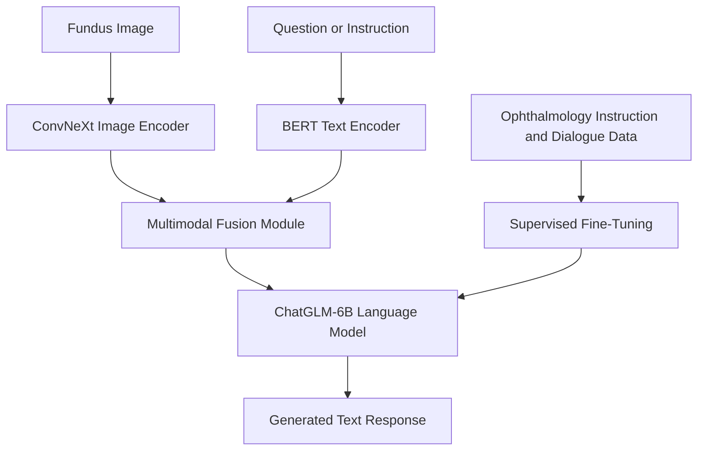

# 👁️ OphGLM — Ophthalmology Large Language-and-Vision Assistant

### Bridging Medical Image Understanding and Conversational AI for Ophthalmic Research

<p align="center">
  
  
  
  
  
</p>

---

## 🔬 Overview

**OphGLM** is a research project exploring the integration of large language models and medical image understanding for ophthalmology.

Designed as a large language-and-vision assistant, OphGLM combines fundus image representations, ophthalmic knowledge, and doctor–patient dialogue data to investigate multimodal question answering and disease-related clinical information processing.

The project brings together computer vision, natural language processing (NLP), multimodal representation learning, and supervised fine-tuning to explore how AI systems can connect visual information with medical language.

Its development introduces **FundusTuning-CN**, a fundus-oriented instruction and conversation dataset intended to support the adaptation of language models to ophthalmology-related tasks.

> **Research vision:** Connect what an AI model can interpret from an ophthalmic image with what it can explain through natural language.

## ✨ Key Highlights

- 👁️ **Ophthalmic image understanding:** Use fundus images to investigate disease-related visual patterns.
- 🧠 **Multimodal architecture:** Integrate image encoding, text encoding, feature fusion, and a large language model.
- 💬 **Instruction-based learning:** Structure ophthalmic knowledge into visual diagnostic instructions and disease-related question-answering tasks.
- 🗣️ **Clinical dialogue modeling:** Explore doctor–patient conversations for ophthalmology-specific language understanding.
- 🔗 **Dynamic Label Pairing Strategy (DLPS):** Incorporate a strategy for pairing image-related labels and language supervision.
- 🤖 **LLM adaptation:** Build on ChatGLM-6B with image-text and text-only fine-tuning data.

---

## 📚 Table of Contents

- [Motivation](#-motivation)
- [System Architecture](#-system-architecture)
- [Core Modules](#-core-modules)
- [Dataset](#-dataset)
- [Building Process](#️-building-process)
- [Training Strategy](#-training-strategy)
- [Getting Started](#-getting-started)
- [News](#-news)
- [Research References](#-research-references)
- [Limitations and Medical Disclaimer](#️-limitations-and-medical-disclaimer)

---

## 🎯 Motivation

Ophthalmology involves interpreting complex visual information while integrating medical knowledge, examination findings, symptoms, and patient history.

Traditional image classification models are designed primarily to predict labels. Large language models, meanwhile, can process and generate natural language but require appropriate visual grounding to reason about medical images.

OphGLM investigates how these capabilities can be brought together in a single research framework.

The project focuses on three central challenges:

**1. Connecting visual and linguistic information**

Develop a multimodal architecture that links fundus image representations with ophthalmology-related language.

**2. Building domain-specific supervision**

Construct instruction and conversation datasets that cover disease knowledge, visual diagnostic tasks, examination, treatment, prevention, prognosis, and lifestyle information.

**3. Supporting interactive medical AI research**

Explore whether a domain-adapted language-and-vision model can respond to ophthalmology-related questions using visual and textual context.

The broader objective is to investigate more interactive medical AI systems while recognizing that clinical usefulness must be established through rigorous evaluation.

---

## 🏗️ System Architecture

OphGLM combines four principal components to process visual and textual information.



The architecture is designed to connect visual representations with language-based instructions and responses.

The exact tensor dimensions, projection layers, fusion mechanism, and information flow should be documented from the implementation.

### Core components

| Component | Model or Method | Role |
|---|---|---|
| Image encoder | ConvNeXt | Extract visual representations from fundus images |
| Text encoder | BERT | Encode textual input |
| Fusion module | Project-specific module | Integrate visual and textual representations |
| Language model | ChatGLM-6B | Generate natural-language responses |
| Fine-tuning data | FundusTuning-CN | Provide ophthalmology-related instructions and conversations |

---

## 🧩 Core Modules

### 1. Clinical instruction dataset construction

OphGLM investigates the creation of disease-specific fine-tuning data using foundational medical knowledge and doctor–patient conversations.

The dataset-building approach addresses the difficulty of collecting sufficiently diverse dialogue data for particular ophthalmic diseases, especially rare conditions.

<details>
<summary><strong>Instruction dataset categories</strong></summary>

- **Visual Diagnostic Instructions:** Questions and instructions related to visual findings in fundus images.
- **Causes and Symptoms:** Disease-related causes, manifestations, and symptoms.
- **Diagnosis and Examination:** Diagnostic concepts and relevant examination procedures.
- **Treatment and Prevention:** Medical management and preventive information.
- **Prognosis and Lifestyle:** Disease outlook and related lifestyle considerations.

</details>

### 2. Dynamic Label Pairing Strategy

The project includes a Dynamic Label Pairing Strategy (DLPS) for constructing relationships between visual classification labels and language-based supervision.

This component belongs to the broader effort to connect image-level disease representations with natural-language instructions.

The exact pairing rules, sampling procedure, and training objectives should be described using the implementation or accompanying research paper.

### 3. Multimodal model integration

The project combines an image encoder, text encoder, fusion module, and large language model to investigate image-conditioned language generation.

The intended workflow connects visual input with ophthalmology-related questions and produces a textual response.

### 4. Supervised fine-tuning

The model development process incorporates image-text and plain-text training data to adapt the language model to ophthalmology-related tasks.

This provides a research framework for investigating domain-specific language generation and multimodal comprehension.

---

## 🗂️ Dataset

OphGLM uses ophthalmology-related image and text resources to support model development.

### Fundus image data: ODIR-5K

The project uses the <a href="https://www.kaggle.com/datasets/tanjemahamed/odir5k-classification">ODIR-5K fundus image dataset</a> as a source for selecting disease-related images.

The documented categories include:

- Diabetic Retinopathy (DR)
- Age-related Macular Degeneration (AMD)
- Glaucoma
- Myopia
- Cataracts

These categories support the image encoder's multi-disease classification pretraining task described in the project.

### FundusTuning-CN

FundusTuning-CN is the project’s ophthalmology-oriented instruction and conversation dataset.

It is intended to provide domain-specific supervision for language-model adaptation.

The described data sources include:

- Ophthalmology doctor–patient dialogue records from 2010–2020.
- JSON-formatted fine-tuning data samples.
- Fundus-related instruction examples.
- Conversations covering varying levels of ophthalmic knowledge.

### Dataset design

The data construction approach emphasizes two complementary sources of supervision:

| Data Type | Purpose |
|---|---|
| Foundational medical knowledge | Provide disease-related background information |
| Doctor–patient dialogues | Support conversational language understanding |
| Fundus image labels | Support visual disease classification |
| Image-related instructions | Connect visual information with language-based tasks |
| Text-only examples | Support domain-specific language fine-tuning |

**Data considerations:** Verify the dataset's size, language coverage, licensing, de-identification status, and clinical provenance before redistributing it or using it in downstream research. Historical medical dialogue and patient-related data require particular care.

---

## ⚙️ Building Process

The development process consists of three major stages.

### Stage 1 — Constructing the image classification model

The first stage develops a visual encoder capable of learning representations from fundus images.

**Workflow:**

1. Select relevant fundus images from ODIR-5K.
2. Organize the selected images according to the documented disease categories.
3. Use ConvNeXt as the image encoder.
4. Pretrain the encoder on a multi-disease classification task.
5. Prepare the resulting visual representations for multimodal integration.

Dataset reference: [ODIR-5K on Kaggle](https://www.kaggle.com/datasets/tanjemahamed/odir5k-classification).

### Stage 2 — Collecting and constructing fine-tuning datasets

The second stage develops language supervision for ophthalmology-related tasks.

**Fundus Instruction Set**

The instruction data covers five broad categories:

1. Visual diagnostic instructions.
2. Causes and symptoms.
3. Diagnosis and examination.
4. Treatment and prevention.
5. Prognosis and lifestyle.

**Fundus Conversation Set**

The conversation data contains fundus-related discussions designed to represent ophthalmology-specific dialogue and knowledge.

Together, these datasets support the adaptation of a general-purpose language model to the project's target domain.

### Stage 3 — OphGLM multimodal integration

The third stage connects the image and language components.

**Architecture components:**

- ConvNeXt image encoder.
- BERT text encoder.
- Multimodal fusion module.
- ChatGLM-6B language model.

The integration aims to connect visual representations with linguistic context for ophthalmology-related question answering.

---

## 🧠 Training Strategy

The documented training process contains three principal steps.

### Step 1: Pretrain the image encoder

Train the image encoder on a multi-disease classification task using selected fundus images.

This stage establishes the visual representations used in the downstream multimodal framework.

### Step 2: Tune the fusion module

Train the fusion module using a visual question-answering task while restricting parameter updates to that module, as described in the project methodology.

This stage focuses on learning how image and text representations should be integrated.

### Step 3: Fine-tune the language model

Apply supervised fine-tuning with image-text and plain-text data to adapt the language model to ophthalmology-related instructions and conversations.

The resulting model is intended to investigate multimodal question answering and domain-specific response generation.

---

## 🚀 Getting Started

### Prerequisites

The documented architecture uses several established deep learning components:

- Python
- PyTorch
- Transformers
- ConvNeXt
- BERT
- ChatGLM-6B
- Access to the required image and text datasets

These are architecture-level dependencies. The exact package versions and additional requirements should be obtained from the project's source code.

### 1. Clone the repository

Use the repository URL associated with the OphGLM source code.

```bash
git clone <OPHGLM_REPOSITORY_URL>
cd OphGLM
```

Replace the placeholder with the verified repository URL before running the commands.

### 2. Create a virtual environment

```bash
python -m venv .venv
```

Activate it on Windows:

```bash
.venv\Scripts\activate
```

On macOS or Linux:

```bash
source .venv/bin/activate
```

### 3. Install project dependencies

If the repository includes a `requirements.txt` file:

```bash
pip install -r requirements.txt
```

For GPU-based training, verify compatibility among the installed PyTorch build, CUDA version, model dependencies, and available hardware.

### 4. Prepare the datasets

Obtain the required fundus images and permitted text data. Arrange the files according to the actual preprocessing and training scripts.

Do not upload restricted medical data or credentials to a public repository.

### 5. Run the implementation

Follow the execution order provided by the repository's scripts, notebooks, or official documentation.

**Reproducibility note:** Exact commands for preprocessing, image encoder pretraining, fusion-module training, and language-model fine-tuning should be added after verifying the available implementation files.

---

## 📰 News

- **September 30, 2024:** Core code and sample data were uploaded.

---

## 📖 Research References

### Base language model

- [ChatGLM-6B — Official GitHub Repository](https://github.com/THUDM/ChatGLM-6B)

### Fundus image dataset

- [ODIR-5K — Dataset Reference](https://www.kaggle.com/datasets/tanjemahamed/odir5k-classification)

### Model architecture

- [ConvNeXt — Official Repository](https://github.com/facebookresearch/ConvNeXt)
- [BERT — Research Paper](https://arxiv.org/abs/1810.04805)

For formal academic citation, add the OphGLM paper or preprint, its authors, publication venue, and DOI or archival identifier if available.

---

## 🔭 Future Research Directions

### Expanded multimodal evaluation

Evaluate the model on ophthalmology-specific question-answering benchmarks and clearly distinguish image-grounded tasks from text-only tasks.

### Improved clinical grounding

Investigate methods for grounding generated responses in image findings and trusted medical references.

### Robustness and generalization

Evaluate performance across different imaging devices, patient populations, and clinical settings.

### Explainability

Explore ways to inspect which image regions and textual inputs influence model responses.

### Responsible deployment

Investigate uncertainty estimation, refusal behavior, privacy protection, and clinician oversight before considering clinical applications.

### Reproducible benchmarking

Publish dataset descriptions, training configurations, evaluation protocols, and benchmark results to support independent verification.

---

## ⚠️ Limitations and Medical Disclaimer

OphGLM is a research project, not an established medical diagnostic system.

- Generated responses may be incorrect, incomplete, or unsupported by the supplied image.
- Image classification performance does not establish clinical diagnostic reliability.
- The quality of outputs depends on the training data, annotation quality, model architecture, and evaluation process.
- Medical image and dialogue datasets may contain biases and privacy-sensitive information.
- Clinical use requires appropriate validation, qualified professional oversight, and compliance with relevant regulatory and data-protection requirements.

The model must not be used as a substitute for professional medical advice, diagnosis, or treatment.

---

## 🌟 Final Thoughts

OphGLM explores an important direction in medical artificial intelligence: combining visual understanding with conversational language capabilities.

By integrating ConvNeXt, BERT, ChatGLM-6B, and ophthalmology-specific instruction data, the project investigates how image-based representations and medical language can work together in a unified research framework.

Its broader significance lies in exploring **multimodal AI that can connect visual evidence with natural-language interaction**, while emphasizing the evaluation, transparency, and clinical validation required for responsible healthcare applications.

<p align="center">
  <strong>Connecting vision, language, and ophthalmic AI research.</strong>
</p>
